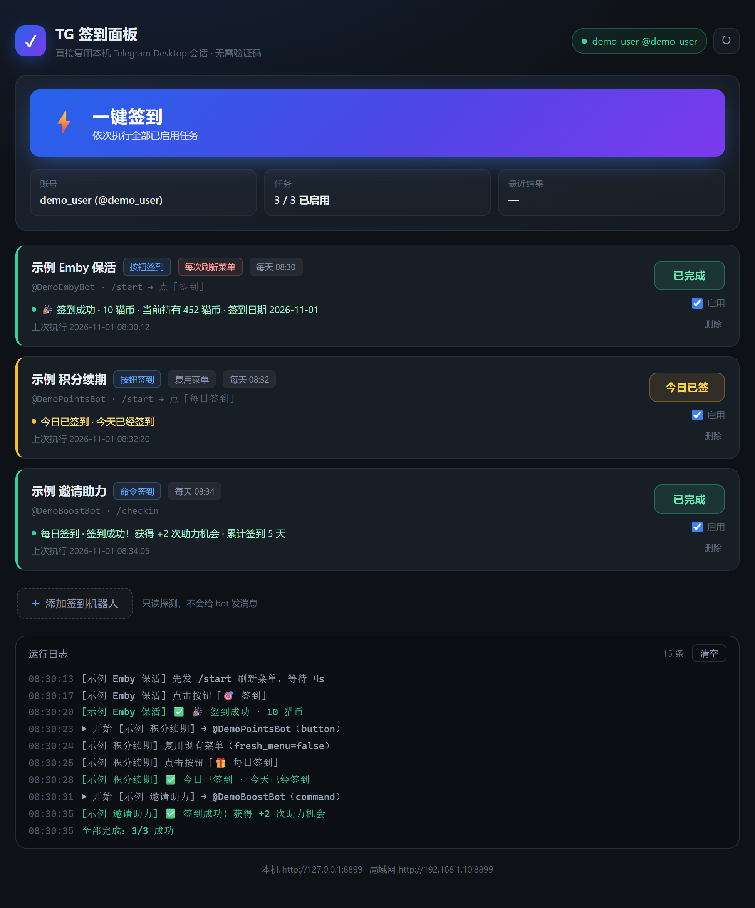

# TG 签到面板

本机 Telegram Desktop 的签到面板。**不需要 api_id、不需要验证码**——直接接管桌面端已授权的会话，点一下就把所有 bot 签到搞定。



## 为什么不用别的方案

网上同类项目（telegram-checkin-bot、各种青龙脚本、GitHub Actions 方案）基本都是「发固定命令 → 点固定按钮文字」。实际用起来会撞三个坑，这个项目都处理了：

| 坑 | 表现 | 本项目的处理 |
|---|---|---|
| **菜单消息被覆盖** | 点签到后，bot 把那条带按钮的菜单消息**原地改成签到结果**。下次复用旧菜单 = 在结果上再点，整个面板被毁 | `fresh_menu` 每次先发命令刷新菜单，且只认新消息上的按钮（`min_id` 硬约束） |
| **回执只在弹窗里** | bot 不发消息，只弹一个小提示（如「今天已经签到」），聊天记录一个字都没有 | 优先读 `BotCallbackAnswer.message` |
| **原地编辑消息** | bot 把面板消息内容改掉，消息 id 不变 | 比对文本变化，不只比 id |

## 快速开始

### 1. 环境

```bash
python -m venv .venv
.venv\Scripts\pip install -r requirements.txt
```

macOS / Linux：

```bash
python3 -m venv .venv
source .venv/bin/activate && pip install -r requirements.txt
```

### 2. 启动

Windows 双击 `run.bat`，或手动：

```bash
.venv\Scripts\python app.py
```

打开 <http://127.0.0.1:8899>。

启动时自动从本机 Telegram Desktop 的 `tdata` 读出已授权会话，**桌面端不用退出**。

### 3. 配置代理

国内环境必需。改 `config/settings.json`：

```json
{
  "telegram": {
    "proxy": { "enabled": true, "type": "socks5", "addr": "127.0.0.1", "port": 7890 }
  }
}
```

### 4. 添加签到机器人

面板底部「添加签到机器人」：

1. 填 `@用户名` 或粘 `t.me/xxx` 链接
2. 点「探测」——**只读历史消息，不会给 bot 发任何东西**
3. 可能的签到按钮会按可信度排序，「🎯 签到」这类标绿置顶，「English / 帮助」压到底部
4. 点一下填进匹配规则，保存

## 它是怎么接管会话的

Telegram Desktop 把授权信息加密存在 `tdata/` 里：

```
tdata/key_datas        TDF 容器：salt / 加密的 localKey / 加密的账户索引
tdata/<16位HEX>s       该账号的 MTP 授权数据（user_id、主 DC、各 DC 的 auth_key）
```

解密流程（`tdata_session.py`，纯 Python 实现 AES-256-IGE，不需要 pycryptodome）：

1. 读 `key_datas`，空密码派生 rootKey（PBKDF2-HMAC-SHA512，**输出 256 字节**）
2. 解开 localKey（256 字节 MTP 主密钥）
3. 用 localKey 解 `<账号>s`，取出 user_id 和各 DC 的 auth_key
4. 写进 Telethon 的 SQLite session

几个容易踩错的点，都写在 `tdata_session.py` 顶部的 docstring 里：

- `key_datas` 的明文段是 **3 个 Qt QByteArray**（大端 uint32 长度前缀），不是固定头部
- `CreateLocalKey` 的 **dklen 必须是 256 字节**（PBKDF2 输出长度会影响结果）
- `DecryptLocal` 返回**未截断**的明文
- 有没有设本地密码，看 trailer 的 `wrapCount`（偏移 12）

如果桌面端设了本地密码（Passcode），会明确报错而不是瞎猜。

## 任务配置

`config/settings.json` 里每个任务的字段：

| 字段 | 说明 |
|---|---|
| `mode` | `button` 发指令后点按钮 · `command` 直接发命令 |
| `command` | 先发送的指令，通常 `/start` 或 `/checkin` |
| `button_match` | 按钮文字的正则，默认 `签到` |
| `success_keywords` | 判定成功的关键词数组 |
| `cron_time` | 每日执行时间 `HH:MM` |
| `fresh_menu` | **每次先发指令刷新菜单**。不确定时保持 `true` |
| `cleanup_command` | 成功后删掉自己发的指令消息 |

## 防打扰

签到 bot 一般对频率敏感，连续触发可能被限流甚至封号。所以：

- **探测默认只读**，只有历史里完全没有按钮、且显式传 `send=true` 才发一次，发完立刻删
- **今日已签 → 完全不发消息**，直接返回缓存状态
- 单任务单日真跑上限 3 次（`?force=true` 可绕过，用于调试）

## 接口

| 路径 | 说明 |
|---|---|
| `GET /api/status` | 连接状态、账号、局域网地址 |
| `GET /api/probe?target=@x` | 只读探测签到入口 |
| `POST /api/run_all` | 全部签到 |
| `POST /api/run/{id}?force=true` | 单个签到，`force` 跳过已签判断 |
| `GET /api/peek?bot=@x` | 查看某 bot 最近消息（调试） |

## 目录

```
app.py             FastAPI 后端（8899，仅监听 127.0.0.1）
checkin_engine.py  签到引擎：连号、已签判断、点按钮/发命令、三级回执
tdata_session.py   从 tdata 解密导出会话
scheduler.py       每日定时 + 防风控随机抖动
config_manager.py  任务持久化
static/            前端
config/            运行时生成，含凭据，已在 .gitignore 里
```

## 安全

- `config/tg_session.session` **等同于账号授权凭据**，已在 `.gitignore` 排除
- 服务只监听 `127.0.0.1`，不对外暴露
- 想局域网访问需自己改 `app.py` 的 host，并且要意识到：任何能访问这个端口的人都能用你的账号

## 许可

MIT
